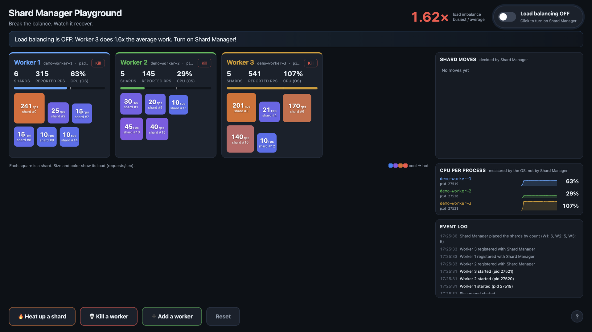
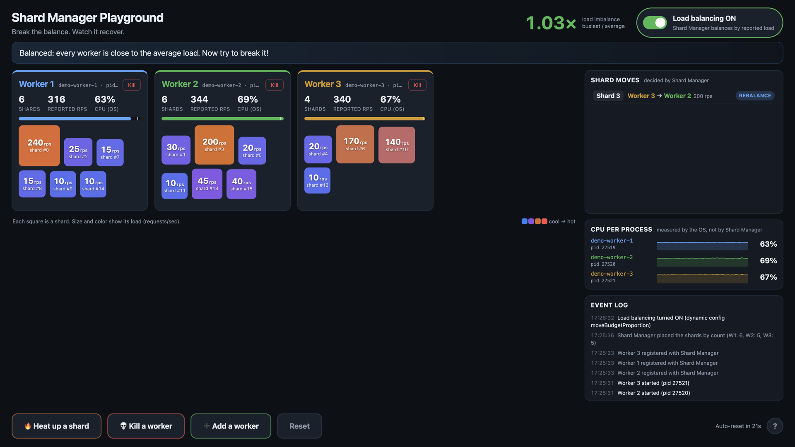
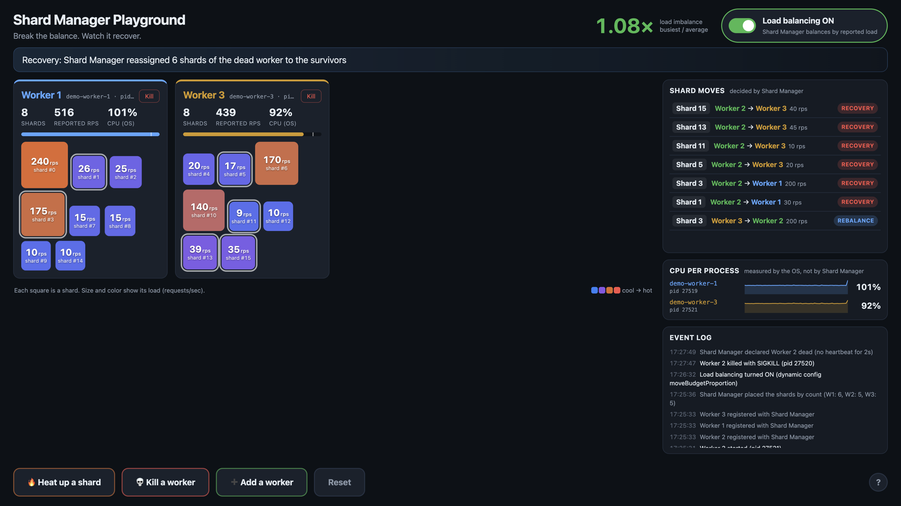
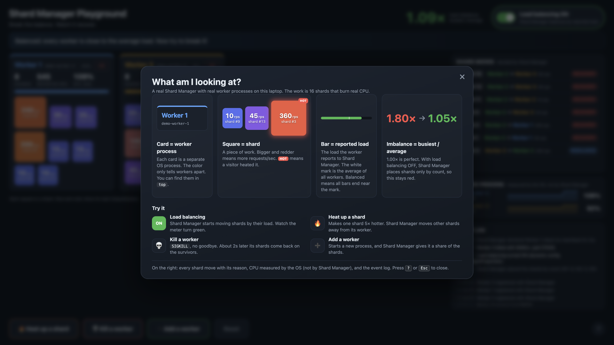

# Shard Manager Playground

**Break the balance. Watch it recover.**

A small interactive demo of the real [Shard Manager](https://github.com/cadence-workflow/shard-manager).
Three real worker processes own 16 shards and burn real CPU for them. Visitors heat up shards,
kill workers, and add workers. The real Shard Manager decides where every shard goes.

Nothing is simulated: the UI only shows what Shard Manager reports, and the CPU numbers come
from the OS.

**Load balancing OFF.** Shards are placed only by count, so Worker 3 does 1.6× the average work:



**Load balancing ON.** A few seconds later Shard Manager moves one hot shard, and the load is even (1.03×):



**Kill a worker.** Shard Manager notices the missing heartbeat and moves its shards to the survivors:



**Press `?`** for a short guide to the screen:



## Run it

You need Go 1.26, `etcd` (`brew install etcd`), and a checkout of Shard Manager next to this repo
(`../shard-manager`, or set `SHARD_MANAGER_DIR`).

```
make demo
```

Open <http://localhost:8080>. Ctrl-C stops everything: workers, the server and etcd.

No native etcd? Use Docker for etcd only (the workers must stay native, so they are visible in `top`):

```
docker compose up -d etcd
make demo ETCD_BIN=
```

## What runs

```
demo-controller            web UI, process lifecycle, workload demand table
├── playground-etcd        fresh data dir on every start
├── shard-manager-server   real server, config in config/, namespace "playground" (fixed, 16 shards)
└── demo-worker-1..N       real executors (executorclient), one OS process each
```

- **Workers** register with Shard Manager through the real `executorclient` (heartbeat every 500ms).
  For each shard they are assigned, they run requests at the shard's target rate. One request is a
  fixed piece of integer math (~2ms on an M-series performance core). Each worker reports the rate it
  actually completed as the shard load (`ShardReport.ShardLoad`).
- **The workload generator** is the controller's demand table (`GET /api/demand`): the target RPS per
  shard. Workers only run demand for shards they own, so the work follows ownership.
- **Shard Manager** decides placement with its greedy load balancer. The controller only reads
  state (`GetFullNamespaceState`) and turns differences between two reads into the moves list.
- **CPU** in the UI is per-process CPU time from `ps` (macOS) or `/proc` (Linux). It is
  independent of Shard Manager, so it is evidence that the work really moved.

## The four buttons

| Action | What really happens |
| --- | --- |
| Load balancing ON/OFF | Rewrites dynamic config `moveBudgetProportion` (0 = no load-based moves). The server reads it within ~5s. |
| Heat up a shard | Raises that shard's target RPS 5x (min 200, max 360). The owner burns more CPU and reports more load. |
| Kill a worker | `SIGKILL`, with no draining. Shard Manager notices after the 2s heartbeat TTL and reassigns the shards. |
| Add a worker | Starts a new process. Shard Manager gives it a share of shards, and load balancing tunes it further. |
| Reset | Drains all workers, waits until Shard Manager forgets them, then starts 3 fresh ones with balancing OFF. |

After 90s without any visitor action, the playground resets by itself (`-idle-reset`).

Press `?` (or the `?` button in the corner) to open a short guide that explains the screen to a visitor.

## Booth script (30-60 seconds)

1. "These are 3 real processes running 16 shards. Load balancing is off, so look at the imbalance:
   one worker does 1.5-2x the average work. You can see it in the CPU column too."
2. Visitor clicks **Load balancing ON**. Within a few seconds Shard Manager moves 2-4 shards and
   the meter goes green.
3. Visitor clicks a big shard. It becomes HOT, and Shard Manager moves the other shards away from
   its worker.
4. Visitor kills a worker. The card greys out, and ~2s later the shards appear on the survivors
   (`recovery` in the moves list).
5. Visitor adds a worker. It joins and gets shards.
6. **Reset** for the next visitor.

## Show the processes outside the browser

```
make htop   # htop --filter demo-worker (brew install htop)
make top    # plain top for the current workers
```

The workers appear as `demo-worker-1`, `demo-worker-2`, ... in `ps`, `top` and `htop`.

## Tradeoffs and tuning

- **Faster balancer knobs.** The greedy balancer is tuned through its real dynamic config keys, for
  this namespace only (`internal/controller/dynconfig.go`): 3s load smoothing instead of 1m, 5s
  per-shard cooldown instead of 1m, and 20% move budget instead of 1%. The algorithm is unchanged;
  it just reacts within seconds instead of minutes.
- **The baseline is skewed on purpose** (`internal/workload/work.go`): four heavy shards and a long
  tail. Shard Manager places the first shards by count, so with balancing OFF the workers are
  visibly imbalanced most of the time. The exact numbers change with every reset, because the
  placement is Shard Manager's.
- **A single hot shard cannot be split.** If one shard is hotter than an average worker,
  Shard Manager leaves it alone on its worker and moves everything else away. The narration
  explains this when it happens.
- **Pull model for demand.** Workers poll the demand table instead of receiving routed requests.
  This keeps the demo simple, and no request is lost while a shard moves. Workers exit if the
  controller is unreachable for 3s, so they never become orphans.
- **The ON/OFF toggle takes up to ~5s.** The file-based dynamic config has a 5s minimum poll
  interval. Failure recovery and new-worker placement always run, even with balancing OFF.

## Layout

```
cmd/demo-controller   fx app: smclient + controller
cmd/demo-worker       fx app: smclient + worker + upstream executorclient module
internal/controller   processes, state observer, move detection, actions, SSE
internal/worker       ShardProcessor, demand polling, fx wiring
internal/workload     CPU work unit, baseline demand
internal/smclient     YARPC gRPC clients for shard-manager-server
web/                  static UI (vanilla JS), embedded into the controller
config/               shard-manager-server config
```

`make test` runs `go vet` and the unit tests.
